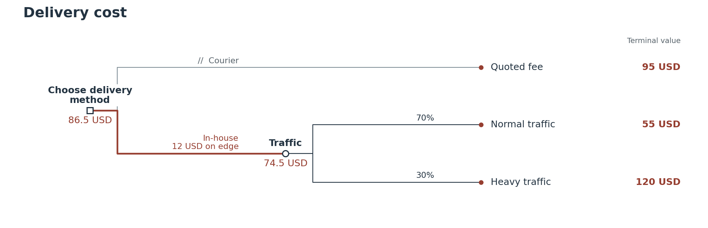
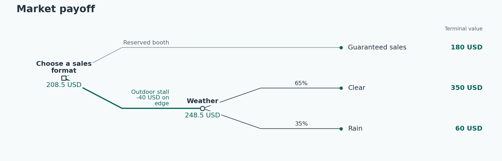
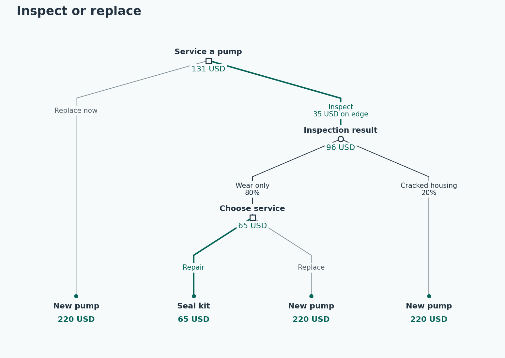
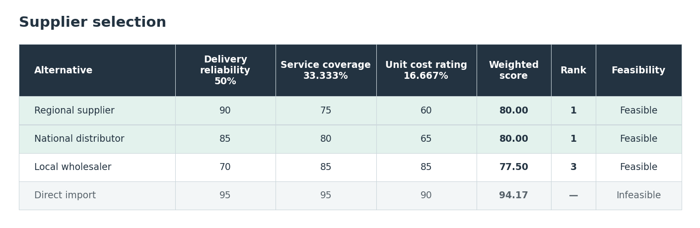

# Decision Tree Diagrams

Draw decision trees and calculate expected costs or payoffs by backward induction. Use weighted decision tables to rank alternatives against a common set of criteria.

Squares mark decisions, circles mark chance nodes, and dots mark outcomes. A node's value summarizes the costs or payoffs from that point onward.

## Install

With Python 3.10 or later, install from [PyPI](https://pypi.org/project/decision-tree-diagrams/).

```sh
python -m pip install decision-tree-diagrams
```

To run the examples, clone the repository and run the commands below from its root.

## Command line

```sh
decision-tree-diagrams evaluate examples/delivery-cost.json
decision-tree-diagrams render examples/delivery-cost.json delivery.svg --units USD
decision-tree-diagrams render examples/market-payoff.json market.pdf --objective max --style modern
decision-tree-diagrams render examples/inspect-or-replace.json pump.png --style top-down
```

The CLI writes a diagram in the format given by the output extension. Use SVG or PDF for vector output or PNG for raster output. Use `--title` to add a heading and `--units` to label numeric values. Units beginning with `$` use a dollar prefix and up to two decimal places, so `--units '$M'` displays amounts such as `$9.71M`. The `evaluate` command emits structured JSON. Both commands take `--objective min` (the default) or `--objective max`.

## Examples and styles

### Delivery cost · classic

A courier charges a flat fee. In-house delivery adds a dispatch fee and incurs costs based on traffic. The minimum expected cost is 86.50 USD. Classic uses orthogonal branches and marks unselected actions with double slashes. All styles show optimal actions with thicker lines, draw zero-probability outcomes with dashes, and align terminal values for comparison.



### Market payoff · modern

A reserved sales booth brings in a fixed amount. The outdoor stall pays a setup fee and sales depend on the weather. The maximum expected payoff is 208.50 USD. Modern uses diagonal branches and a green accent.



### Inspect or replace · top-down

A pump can be replaced immediately or inspected first. If inspection finds only wear, a second decision compares repair and replacement. The minimum expected cost is 131 USD. Top-down uses a vertical layout with the initial decision at the top.



## JSON format

Start with any JSON example under `examples/` and edit its labels, values, and branches. The file contains one root node, with child nodes nested inside branches.

| Node type | Required fields |
| --- | --- |
| `decision` | `type`, `label`, `branches` |
| `chance` | `type`, `label`, `branches` |
| `terminal` | `type`, `label`, `value` |

Each decision or chance node has a nonempty `branches` array. Each branch has a `child` node and may have a string `label` or numeric `value` (default zero). Chance branches also require `probability`, a number between zero and one. Probabilities from the same chance node must sum to one, within an absolute tolerance of 0.000000001. Probabilities can be zero. Unknown fields and nonfinite numeric values are rejected.

A terminal value is the cost or payoff at that outcome. A branch value is a one-time increment on that edge, added to its child’s expected value. Enter each cost or payoff once, on the edge where it is incurred or at a terminal outcome. Use positive costs when minimizing and negative expenses when maximizing net payoff.

## Python

```python
from decision_tree_diagrams import Branch, Chance, Decision, Terminal, evaluate, render

tree = Decision("Ship a parcel", [
    Branch(Terminal("Courier quote", 95), label="Courier"),
    Branch(Chance("Traffic", [
        Branch(Terminal("Normal", 55), probability=0.7),
        Branch(Terminal("Heavy", 120), probability=0.3),
    ]), value=12, label="In-house"),
])

result = evaluate(tree)
print(result.expected_value)  # 86.5
print(result.chosen_edges)    # (1,)

fig = render(tree, style="classic", units="USD", title="Delivery cost")
fig.savefig("delivery.pdf")
```

`load_json(path)` validates a JSON file and returns its root node for use with either function. `render` returns a Matplotlib `Figure`. Set `figure_size=(width, height)` in inches to fit a particular page or expand space for long labels.

`evaluate` returns an `Evaluation` with `expected_value`, `chosen_edges` (zero-based indices for optimal decision branches), `children` (nested evaluations in branch order), and `branch_values` (child expected values including their incoming increments). Decision ties use absolute and relative tolerances of 0.000000000001. The result retains every tied choice and every child, including zero-probability outcomes.

## Weighted decision tables

When several options are judged against the same criteria, assign a weight to each criterion and a rating from 0 to 100 to each option. Higher ratings are better. For a criterion such as cost, map lower costs to higher ratings before passing them in.

```python
from decision_tree_diagrams import Alternative, Criterion, render_table, score_table

criteria = [Criterion("Reliability", 3), Criterion("Convenience", 1)]
alternatives = [
    Alternative("Standard", [60, 100]),
    Alternative("Premium", [80, 80]),
    Alternative("Unavailable", [95, 95], feasible=False),
]
for row in score_table(criteria, alternatives):
    print(row.alternative.label, row.score, row.rank)
# Premium 80.0 1
# Standard 70.0 2
# Unavailable 95.0 None

render_table(criteria, alternatives, title="Compare suppliers").savefig("suppliers.pdf")
```

Weights are relative and must be nonnegative, with at least one positive weight. Give each alternative one rating per criterion, in criterion order. The weighted score is the sum of each rating multiplied by its normalized weight. Feasible options are ranked by score. Scores within 0.000000001 points of the highest score in the tie group share a rank and retain input order. For example, two options tied for first are followed by third place. Infeasible options keep their scores, have a rank of `None`, and follow the ranked options in input order.

The table prints each rating, the normalized criterion weights, the weighted scores, ranks, and feasibility. Run `python examples/supplier-selection.py` to rank the suppliers below and save a PDF.



## Development

```sh
python -m pip install -e .
python -m unittest discover -s tests
```
